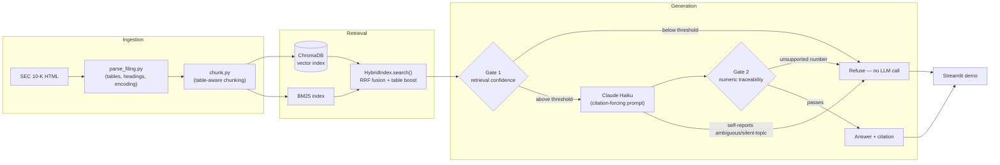

# AI Due Diligence Copilot

[](https://github.com/arkhamknight147/ai-due-diligence-copilot/actions/workflows/ci.yml)

A grounded RAG assistant that answers factual questions from SEC 10-K filings — built to demonstrate table-aware retrieval and an explicit, code-enforced refusal policy against fabricated numbers, not to give investment advice.

**Status: functional prototype, validated against a real baseline.** Ingestion, table-aware chunking, hybrid retrieval, and generation with refusal gates are built, unit-tested (42 tests), and verified against three real filings (not just synthetic fixtures). A real 30-question eval run (live Anthropic API, real golden set) found and fixed five Gate 2 false-positive bugs, taking `false_refusal_rate` from 0.652 to 0.478 and `numeric_exact_match_rate` from 0.267 to 0.467 — see [`docs/TRADE_OFFS.md`](docs/TRADE_OFFS.md) Section 11 for the full trail and remaining known limitations. `faithfulness`/`context_precision`/`answer_relevance` still need an LLM-judge wiring that hasn't been built yet; see [`docs/EVALS_AND_BENCHMARKS.md`](docs/EVALS_AND_BENCHMARKS.md).

## The problem

Real-world RAG accuracy on financial questions collapses from ~89% under ideal retrieval conditions to under 20% under realistic ones — and a confident, well-cited-looking *wrong* answer is worse than no answer, because it invites a PE/VC deal-team associate to act on it without double-checking. Full evidence, market sizing, and the decision to build this over two other candidate projects: [`docs/PROBLEM_AND_SOLUTION.md`](docs/PROBLEM_AND_SOLUTION.md).

## What this demonstrates

- **Table-aware chunking** — financial tables are never split mid-row, which naive fixed-size chunking does (the root-cause failure mode this project targets).
- **Hybrid retrieval** — BM25 keyword search + vector similarity, merged with Reciprocal Rank Fusion, so exact numeric lookups aren't missed by embedding similarity alone.
- **A code-enforced refusal policy**, not just a prompted one — the two gates that can be mechanically checked (retrieval confidence, numeric-claim traceability) are checked in code, independent of what the model claims about itself. See [`docs/PRD.md`](docs/PRD.md) Section 5.
- **A documented trail of real findings**, not a polished-looking demo — see [Engineering log](#engineering-log-what-actually-happened) below. This is deliberate: the project's own thesis is that AI products should be judged on evidenced groundedness, not confident presentation, so the build process holds itself to the same standard.

## Architecture



Full threat model (all four gates, success metrics, scope): [`docs/PRD.md`](docs/PRD.md).

## Repo structure

```
docs/          PRD, problem/solution analysis, trade-off memo, golden question set, eval report, checkpoint critique
src/
  ingestion/   HTML parsing, table extraction, table-aware chunking
  retrieval/   Hybrid BM25 + vector search (RRF fusion)
  generation/  LLM client, citation-forcing prompt, refusal gates, orchestration
eval/          30-question golden set (.json + reviewable .xlsx) + scoring harness (eval/run_eval.py) + results.json
data/          Raw filings and parsed Markdown output — tracked, not gitignored (see data/README.md); only the
                regenerable Chroma vector index under data/processed/ is gitignored
tests/         42 unit tests across ingestion, retrieval, generation, and the eval harness
app.py         Streamlit demo
```

## Running it yourself

The three frozen filings (raw HTML + parsed, table-aware Markdown) are already committed under `data/` — no download or parsing needed to run the demo or eval as-is.

```bash
pip install -r requirements.txt

# 1. Add your own Anthropic API key (see .env.example)
cp .env.example .env  # then fill in ANTHROPIC_API_KEY

# 2. Run the demo
streamlit run app.py

# 3. Run the eval harness for a real baseline (needs step 1's key)
python -m eval.run_eval
```

`python -m eval.run_eval --dry-run` runs the same harness with a scripted fake model — no API key needed — as a wiring smoke test only; see [`docs/EVALS_AND_BENCHMARKS.md`](docs/EVALS_AND_BENCHMARKS.md) for why its numbers aren't meaningful accuracy results.

<details>
<summary>Regenerating the pipeline from scratch (optional — not needed to run the demo or eval)</summary>

```bash
python src/ingestion/download_filings.py   # re-downloads the three frozen filings from SEC EDGAR
python src/ingestion/parse_filing.py data/raw/aapl-20250927.htm data/processed/aapl-20250927.md
python src/ingestion/parse_filing.py data/raw/msft-20250630.htm data/processed/msft-20250630.md
python src/ingestion/parse_filing.py data/raw/nvda-20250126.htm data/processed/nvda-20250126.md
```

See [`docs/PRD.md`](docs/PRD.md) Section 3 for the exact frozen URLs/dates.
</details>

## Engineering log: what actually happened

This project was built stage by stage, and several real defects were only found by testing against the actual downloaded filings rather than trusting synthetic fixtures or passing unit tests. The full trail, including the honest cost of a design decision that didn't fully work on the first try, lives in [`docs/SOLUTION_CRITIQUE.md`](docs/SOLUTION_CRITIQUE.md) and [`docs/TRADE_OFFS.md`](docs/TRADE_OFFS.md). Highlights:

- A table-column-deduplication bug's *first* fix passed its unit test but was still wrong on the real Apple filing — caught by re-checking against real data, not the test suite.
- Real 10-Ks don't use semantic `<h1>`-`<h6>` heading tags (SEC filings fake headings with bold styled `<div>`s) — section tagging and citations were completely broken on real filings (240/240 chunks tagged "unknown section") until this was found and fixed.
- Gate 1's retrieval-confidence threshold started at 0.70 per the PRD, with a built-in instruction to sanity-check it against real data once a baseline existed. That baseline showed answerable and unanswerable questions' similarity scores overlap almost entirely, and 0.70 alone refused 79% of answerable questions before the model was ever asked. Lowered to 0.60 as an explicit, logged decision — not a silent tuning change.
- A "fix" to help numeric-question retrieval (a small table-chunk boost) improved numeric coverage from 5/15 to 9/15 golden questions at the same retrieval depth, but was also caught promoting an irrelevant "Exhibit Listing" boilerplate table for one textual question — fixed with a narrow, documented exclusion rather than left as a silent false positive.
- The first real eval run (live API key, real golden set) found Gate 2 — the code-enforced numeric-traceability check — refusing *correct* answers for five unrelated reasons: filing-form digits ("10-K" read as the number "10"), markdown list markers, legitimate unit restatements and disclosed arithmetic, a follow-up bug where the first filing-form fix only worked for single-digit forms, and fiscal-quarter labels ("Q3"). Each got a dedicated regression test; `false_refusal_rate` dropped from 0.652 to 0.478 across the fixes. Full trail: [`docs/TRADE_OFFS.md`](docs/TRADE_OFFS.md) Section 11.
- CI's first run on GitHub failed with `OSError: [Errno 28] No space left on device` — `sentence-transformers` pulls in PyTorch's default CUDA-bundled wheel, which drags several GB of unused NVIDIA toolkit packages onto a CPU-only runner. Fixed by installing the CPU-only torch wheel first. See [`docs/TRADE_OFFS.md`](docs/TRADE_OFFS.md) Section 12.

## Current filing scope (frozen for reproducibility)

| Company | Filing | Period end | Chunks | Tables |
|---|---|---|---|---|
| Apple Inc. | FY2025 10-K | 2025-09-27 | 240 | 54 |
| Microsoft Corp. | FY2025 10-K | 2025-06-30 | 301 | 36 |
| NVIDIA Corp. | FY2025 10-K | 2025-01-26 | 384 | 68 |

Newer FY2026 filings exist for Microsoft and NVIDIA as of this writing — deliberately not used, so the golden question set stays valid against a fixed target. See [`docs/PRD.md`](docs/PRD.md) Section 3.

## Docs

- [`docs/PROBLEM_AND_SOLUTION.md`](docs/PROBLEM_AND_SOLUTION.md) — problem discovery, evaluation against two other candidate projects, persona, solution rationale, all claims cited to primary sources
- [`docs/PRD.md`](docs/PRD.md) — scope, threat model, success metrics, decision log
- [`docs/TRADE_OFFS.md`](docs/TRADE_OFFS.md) — engineering trade-offs and fixes, in the order they actually happened
- [`docs/GOLDEN_QUESTION_SET.md`](docs/GOLDEN_QUESTION_SET.md) — the 30-question eval set, verified against the real filings
- [`docs/EVALS_AND_BENCHMARKS.md`](docs/EVALS_AND_BENCHMARKS.md) — what the eval harness measures, what it doesn't (yet), and why
- [`docs/SOLUTION_CRITIQUE.md`](docs/SOLUTION_CRITIQUE.md) — checkpoint self-critiques at each build milestone, including gaps this README doesn't hide

## Non-goals

Not investment advice. Not full-document summarization. Not optimized for latency — groundedness is prioritized over speed for this version. Full list: [`docs/PRD.md`](docs/PRD.md) Section 7.

## License

See [`LICENSE`](LICENSE).
